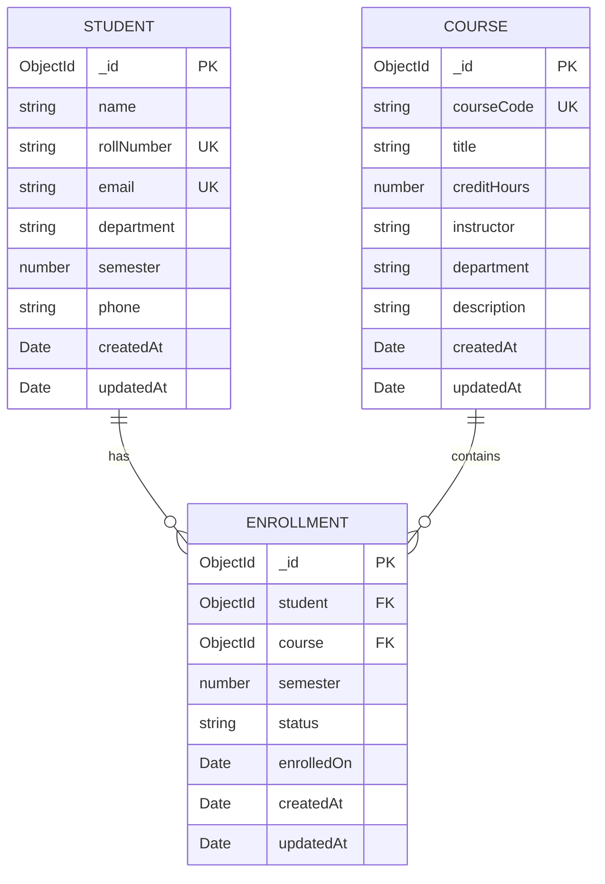

# CampusConnect: Design and Development of a Responsive CRUD-Based University Management System

---

## 1. Project Information & Metadata

- **Project Title:** CampusConnect — University Management System
- **Domain:** Higher Education / Academic Administration Systems
- **Course Title:** SW417 — Web Engineering (Problem-Based Learning - PBL)
- **Course Instructor:** Engr. Asmatullah Zubair
- **Institution:** Department of Software Engineering, Mehran University of Engineering and Technology (MUET), Jamshoro
- **Student Name:** Azharuddin Qambrani
- **Roll Number:** 22SW01
- **Batch:** 22SW / K23SW
- **Academic Year:** 2026

---

## 2. Executive Summary & Problem Statement

### 2.1 Problem Statement
In higher education institutions, academic and student records are frequently stored across disparate paper files or siloed spreadsheets. This leads to common administrative pain points:
- Data redundancy and inconsistency across departments.
- Lack of referential integrity (e.g., student records being deleted while actively enrolled in courses).
- Ineffective manual verification of course prerequisites, credit hours, and duplicate roll numbers.
- Absence of real-time aggregate visibility into campus student enrollments and department metrics.

### 2.2 Proposed Solution: CampusConnect
**CampusConnect** is a centralized, responsive full-stack university management web application engineered to streamline university record-keeping. The system delivers three core relational modules:
1. **Student Management:** Full lifecycle tracking (registration, profile editing, contact details, academic standing).
2. **Course Management:** Curriculum directory (course code, title, credits, department, faculty instructor).
3. **Enrollment Management:** Relational link joining students and courses with semester-level registration tracking, status monitoring (`Enrolled`, `Completed`, `Withdrawn`), and strict referential protection.

---

## 3. Project Objectives

1. **Full-Stack Modular Architecture:** Implement a decoupled Single Page Application (SPA) utilizing React with Vite communicating via RESTful JSON APIs with an Express.js backend.
2. **Complete CRUD Operations:** Deliver Create, Read, Update, and Delete operations for Students, Courses, and Enrollments with instant UI synchronization.
3. **Data Integrity & Relational Constraints:** Enforce strict uniqueness (Roll Numbers, Course Codes, Student Emails) and referential integrity (preventing orphaned records when deleting students or courses).
4. **Resilient Error Handling & UX:** Implement client-side and server-side validation, sanitization against regex injection, clear error notifications, and delete confirmation dialogs.
5. **Responsive & Modern Design:** Craft an accessible, modern dashboard layout optimized across desktop, tablet, and mobile breakpoints with dynamic statistical aggregations.
6. **Cloud Database Persistence:** Store persistent state in a cloud MongoDB Atlas cluster managed through Mongoose schemas.

---

## 4. Technology Stack

| Layer | Technology | Version / Specification | Role in System |
|---|---|---|---|
| **Frontend Framework** | React | ^18.3.1 | Declarative component UI and state management |
| **Frontend Build Tool** | Vite | ^6.0.0 | High-performance bundling, JSX compilation, HMR |
| **Icons & Visuals** | Lucide React | ^0.469.0 | Scalable vector interface icons |
| **Styling** | Vanilla Modern CSS | Custom Design System | CSS variables, responsive grids, flexbox, mobile scrims |
| **Backend Runtime** | Node.js | v20+ / v22 | Asynchronous server execution environment |
| **Backend Framework** | Express.js | ^4.21.2 | REST API routing and middleware pipeline |
| **Database** | MongoDB Atlas | Cloud M0 Cluster | Distributed NoSQL document storage |
| **ODM** | Mongoose | ^8.9.5 | Schema modeling, validation, relationship population |
| **Security Middleware** | Helmet, CORS, Rate-Limit | ^8.0 / ^2.8 / ^7.5 | HTTP security headers, CORS origin control, DoS mitigation |
| **HTTP Client** | Native Fetch API | ES6+ | Typed JSON API requests with centralized error handling |

---

## 5. System Architecture & Request Pipeline

### 5.1 Architectural Diagram
```text
┌────────────────────────────────────────────────────────┐
│                   React + Vite Client                  │
│                     (Port 5173)                        │
└───────────────────────────┬────────────────────────────┘
                            │
               HTTP / JSON (VITE_API_URL)
                            │
                            ▼
┌────────────────────────────────────────────────────────┐
│                   Express.js REST API                  │
│                     (Port 5000)                        │
│  ┌──────────────────────────────────────────────────┐  │
│  │ Middlewares: Helmet, CORS, Morgan, Rate Limiting │  │
│  └────────────────────────┬─────────────────────────┘  │
│                           │                            │
│  ┌────────────────────────▼─────────────────────────┐  │
│  │ Route Handlers: /students, /courses, /enrollments │  │
│  └────────────────────────┬─────────────────────────┘  │
│                           │                            │
│  ┌────────────────────────▼─────────────────────────┐  │
│  │ Mongoose Models & Central Error Handler          │  │
│  └────────────────────────┬─────────────────────────┘  │
└───────────────────────────┼────────────────────────────┘
                            │
                     Mongoose Driver
                            │
                            ▼
┌────────────────────────────────────────────────────────┐
│               MongoDB Atlas Cloud Database             │
│                  (Cluster0 / campusconnect)            │
└────────────────────────────────────────────────────────┘
```

### 5.2 Middleware & Security Pipeline
Every client request undergoes sequential processing before reaching data controllers:
1. **Security Headers (`helmet`):** Secures against XSS, clickjacking, and MIME sniffing.
2. **CORS Control:** Restricts origin access strictly to `CLIENT_ORIGIN` (`http://localhost:5173`).
3. **Payload Inspection:** Express JSON parser with a strict `100kb` body ceiling.
4. **Rate Limiting:** Protects endpoints (`windowMs: 15 mins`, maximum `300 requests` per IP).
5. **Request Logging (`morgan`):** Logs HTTP method, URL, status code, and latency in development mode.
6. **Centralized Error Dispatcher:** Catches asynchronous controller rejections, extracts duplicate key collisions (Mongo error `11000`), and formats standardized JSON error payloads.

---

## 6. Database Schema & Data Modeling



### 6.1 Schema Definitions & Constraints

#### 1. Student Schema (`server/src/models/Student.js`)
- `name`: String, required, trimmed, max 80 chars.
- `rollNumber`: String, required, uppercase, trimmed, **unique index**.
- `email`: String, required, lowercase, trimmed, **unique index**, regex format check.
- `department`: String, required, trimmed.
- `semester`: Number, required, integer range `1` to `12`.
- `phone`: String, optional, trimmed.
- `timestamps`: Automatic `createdAt` and `updatedAt`.

#### 2. Course Schema (`server/src/models/Course.js`)
- `courseCode`: String, required, uppercase, trimmed, **unique index** (e.g., `SW417`).
- `title`: String, required, trimmed, max 100 chars.
- `creditHours`: Number, required, integer range `1` to `6`.
- `instructor`: String, required, trimmed.
- `department`: String, required, trimmed.
- `description`: String, optional, trimmed, max 500 chars.

#### 3. Enrollment Schema (`server/src/models/Enrollment.js`)
- `student`: ObjectId referencing `Student`, required.
- `course`: ObjectId referencing `Course`, required.
- `semester`: Number, required, integer range `1` to `12`.
- `status`: String, required, enum: `['Enrolled', 'Completed', 'Withdrawn']`, default: `'Enrolled'`.
- `enrolledOn`: Date, default `Date.now`.
- **Compound Index:** `{ student: 1, course: 1, semester: 1 }` with `{ unique: true }` prevents duplicate student enrollment in the same course during the same semester.

---

## 7. RESTful API Specification

Base URL: `http://localhost:5000/api`

| Module | Method | Endpoint | Description | Request Body / Query | Success Status |
|---|---|---|---|---|---|
| **Health** | `GET` | `/health` | API & MongoDB connection status | None | `200 OK` |
| **Dashboard** | `GET` | `/dashboard` | Aggregated counts & recent 5 enrollments | None | `200 OK` |
| **Students** | `GET` | `/students` | List/search all students | `?search=term` | `200 OK` |
| **Students** | `GET` | `/students/:id` | Retrieve single student by ID | None | `200 OK` |
| **Students** | `POST` | `/students` | Register a new student | Student JSON object | `201 Created` |
| **Students** | `PUT` | `/students/:id` | Update student profile details | Partial/Full Student JSON | `200 OK` |
| **Students** | `DELETE` | `/students/:id` | Delete student (with enrollment check) | None | `200 OK` / `409 Conflict` |
| **Courses** | `GET` | `/courses` | List/search all courses | `?search=code_or_title` | `200 OK` |
| **Courses** | `GET` | `/courses/:id` | Retrieve single course by ID | None | `200 OK` |
| **Courses** | `POST` | `/courses` | Create a new course offering | Course JSON object | `201 Created` |
| **Courses** | `PUT` | `/courses/:id` | Update course information | Partial/Full Course JSON | `200 OK` |
| **Courses** | `DELETE` | `/courses/:id` | Delete course (with enrollment check) | None | `200 OK` / `409 Conflict` |
| **Enrollments** | `GET` | `/enrollments` | List enrollments (populated) | `?status=Enrolled` | `200 OK` |
| **Enrollments** | `GET` | `/enrollments/:id` | Retrieve single enrollment | None | `200 OK` |
| **Enrollments** | `POST` | `/enrollments` | Enroll student into course | Enrollment JSON object | `201 Created` |
| **Enrollments** | `PUT` | `/enrollments/:id` | Update enrollment status/semester | Partial/Full Enrollment JSON | `200 OK` |
| **Enrollments** | `DELETE` | `/enrollments/:id` | Delete an enrollment registration | None | `200 OK` |

---

## 8. Frontend Interface & Component Structure

### 8.1 Key User Interface Modules
1. **Overview Dashboard:**
   - Real-time KPI Stat Cards: Total Students, Active Courses, Total Enrollments, Active Enrollment Percentage Rate.
   - Quick Action Launchers for instantaneous record creation.
   - Recent Enrollments Activity Feed with student initials avatars, course chips, and status badges.
2. **Directory Views (Students, Courses, Enrollments):**
   - Live debounced search filter.
   - Status dropdown selector for enrollments (`All`, `Enrolled`, `Completed`, `Withdrawn`).
   - Clean data tables with inline edit and delete action controls.
3. **Accessible Dialogs & Forms (`Modal.jsx`, `RecordForm.jsx`):**
   - Modal shell with focus trap, backdrop click, and `Escape` key listeners.
   - Dynamic form generator responding to module schema with built-in validation.
   - Interactive deletion confirmation modal to safeguard against accidental data loss.
4. **Toast Notification System:**
   - Fixed floating alerts delivering immediate user feedback on asynchronous operations.
   - Distinct visual color coding for success (Emerald) and errors (Crimson).

---

## 9. Verification & Testing Matrix

All 22 test specifications documented in `docs/TESTING.md` have been executed against the live application and MongoDB Atlas database.

| Test ID | Area | Test Description | Expected Result | Actual Result | Status |
|---|---|---|---|---|---|
| **T01** | System API | `GET /api/health` with MongoDB Atlas running | HTTP 200, `database: "connected"` | HTTP 200, `{ database: "connected", success: true }` | **PASSED** |
| **T02** | Student | `POST /api/students` with valid data | HTTP 201; student persists in DB | Record `Azharuddin Qambrani` (`22SW01`) created | **PASSED** |
| **T03** | Student | `GET /api/students` and by ID | HTTP 200; returns student profile | Student record retrieved with correct schema | **PASSED** |
| **T04** | Student | `PUT /api/students/:id` update details | HTTP 200; updated data persists | Modified contact and semester correctly updated | **PASSED** |
| **T05** | Student | `DELETE /api/students/:id` (no enrollments) | HTTP 200; record deleted | Unenrolled student deleted successfully | **PASSED** |
| **T06** | Validation | Submit student with missing required fields | HTTP 400; validation message returned | Rejected with detailed field validation error | **PASSED** |
| **T07** | Integrity | Submit duplicate student roll number (`22SW01`) | HTTP 409 Conflict | Returned `"A record with this rollNumber already exists."` | **PASSED** |
| **T08** | Course | `POST /api/courses` with valid course data | HTTP 201; course created in DB | Record `SW417 - Web Engineering` created | **PASSED** |
| **T09** | Course | `GET /api/courses?search=SW417` | HTTP 200; returns matching course | Correct course record returned | **PASSED** |
| **T10** | Course | `PUT /api/courses/:id` update credit hours | HTTP 200; updated value saved | Credit hours and instructor updated | **PASSED** |
| **T11** | Course | `DELETE /api/courses/:id` (no enrollments) | HTTP 200; course record removed | Course deleted successfully | **PASSED** |
| **T12** | Validation | Submit invalid credit hours (e.g., `9`) | HTTP 400; rejected | Validation rejects credit hours outside 1–6 | **PASSED** |
| **T13** | Enrollment | `POST /api/enrollments` linking Student & Course | HTTP 201; enrollment created | Enrollment created linking `22SW01` to `SW417` | **PASSED** |
| **T14** | Enrollment | Filter enrollments by status (`Enrolled`) | HTTP 200; returns active enrollments | Populated student and course records returned | **PASSED** |
| **T15** | Enrollment | Update status to `Completed` | HTTP 200; status persists | Status badge and document updated | **PASSED** |
| **T16** | Enrollment | `DELETE /api/enrollments/:id` | HTTP 200; enrollment removed | Enrollment record deleted cleanly | **PASSED** |
| **T17** | Integrity | Delete student while actively enrolled | HTTP 409; deletion blocked | Returned `"This student has 1 enrollment(s). Remove those enrollments first."` | **PASSED** |
| **T18** | Integrity | Submit enrollment with non-existent student ID | HTTP 404/400; rejected | API rejects orphaned foreign key | **PASSED** |
| **T19** | Persistence | Restart server and re-query database | Data remains intact in Atlas | All records persisted without data loss | **PASSED** |
| **T20** | UX | Cancel delete confirmation in modal | Dialog closes, record unmodified | Modal closes, record remains unchanged | **PASSED** |
| **T21** | Responsive | Inspect viewports on mobile (375px), tablet, desktop | Layout adapts; sidebar collapses | Mobile scrim and toggle drawer function smoothly | **PASSED** |
| **T22** | Build | Production frontend build (`npm run build`) | Zero compilation errors | 1580 modules transformed, build generated | **PASSED** |

---

## 10. Technical Challenges Encountered & Resolutions

1. **Vite React Configuration Missing:**
   - *Challenge:* The initial project lacked a `vite.config.js` file, causing JSX syntax errors during browser bundling.
   - *Resolution:* Created `campusconnect/client/vite.config.js` incorporating `@vitejs/plugin-react` and standard port configurations.
2. **Unhandled Asynchronous Rejections & Server Crashes:**
   - *Challenge:* Database queries in route handlers lacked proper error catching, threatening Node.js process termination on uncaught exceptions.
   - *Resolution:* Wrapped all controllers in `try...catch` blocks delegating to Express `next(err)`. Built central handling in `server/src/middleware/errors.js` to catch Mongo duplicate key error code `11000` and map it to an HTTP 409 status code.
3. **Regex Injection in Search Endpoints:**
   - *Challenge:* Passing unescaped user query strings into `new RegExp(search, 'i')` allowed special characters (`[`, `*`, `+`) to trigger regex compilation errors.
   - *Resolution:* Implemented a sanitization function `escapeRegex(search)` to escape all special regex operators before constructing queries.
4. **Cloud Database Security & IP Whitelisting:**
   - *Challenge:* Initial database connection attempts failed due to placeholder credentials and unset network firewall rules.
   - *Resolution:* Configured MongoDB Atlas Network Access with `0.0.0.0/0` for development, created dedicated database credentials, and populated `campusconnect/server/.env` with the cluster connection string.

---

## 11. Conclusion & Future Work

### 11.1 Conclusion
The **CampusConnect** University Management System successfully satisfies all requirements specified for the SW417 Web Engineering Problem-Based Learning (PBL) project. The system demonstrates:
- A clean, decoupled client-server architecture.
- Full CRUD capabilities across three interrelated academic modules.
- Robust referential integrity and duplicate key safeguards.
- Responsive, modern user experience with instantaneous visual feedback.
- Secure, cloud-persisted storage backed by MongoDB Atlas.

### 11.2 Future Enhancements
- **Role-Based Authentication (RBAC):** Implementing JSON Web Tokens (JWT) or OAuth2 to distinguish between Admin, Faculty, and Student portals.
- **Grade & Attendance Tracking:** Expanding the Enrollment schema to track semester GPA, course assessments, and attendance records.
- **Automated Report Generation:** Exporting student transcripts and course rosters to PDF and CSV formats.
- **Serverless Production Deployment:** Hosting the frontend on Vercel/Netlify and the Express API on Render/Railway with environment-secured Atlas secrets.
